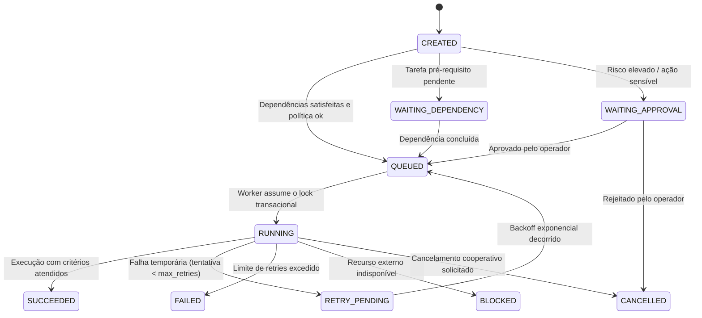

# ORCHESTRATOR — MOTOR DE EXECUÇÃO AUTÔNOMA E RESILIÊNCIA

O **Orquestrador** é o cérebro autônomo do SaaS Validation Lab. Ele roda como um serviço daemon em segundo plano, totalmente independente de sessões de navegador ou IDE.

---

## 1. Máquina de Estados Finitos (FSM)



---

## 2. Resiliência e Proteção contra Falhas

### 2.1 Locks Pessimistas / Transação Atômica no SQLite
O enfileiramento e a captura de jobs pelo Worker utilizam transações atômicas com `BEGIN IMMEDIATE` no SQLite:
```sql
UPDATE execution_jobs
SET status = 'RUNNING', started_at = CURRENT_TIMESTAMP, heartbeat_at = CURRENT_TIMESTAMP
WHERE id = (
  SELECT id FROM execution_jobs
  WHERE status = 'QUEUED'
  ORDER BY created_at ASC
  LIMIT 1
)
RETURNING *;
```
Isso impede que dois workers consumam o mesmo job concorrentemente.

### 2.2 Heartbeats e Detecção de Jobs Órfãos (Zombies)
- A cada 10 segundos de execução, o worker atualiza o campo `heartbeat_at`.
- O Orquestrador executa uma varredura periódica: se um job estiver com status `RUNNING` há mais de 60 segundos sem atualização de heartbeat, ele é classificado como órfão (crash do worker) e recalculado para `RETRY_PENDING` ou `FAILED`.

### 2.3 Backoff Exponencial
Tarefas com erro de rede ou timeout aplicam tempo de espera progressivo:
`delay = base_delay * (2 ^ (tentativas - 1))` (ex: 5s, 10s, 20s).

### 2.4 Pausa Global de Automação
A variável de configuração `GLOBAL_AUTOMATION_PAUSED` no banco de dados e `.env` pode ser acionada a qualquer momento pela interface web. Quando ativa:
- Nenhum novo job com status `QUEUED` é atribuído a workers.
- Os jobs em andamento recebem sinal de cancelamento cooperativo via flag no banco.
